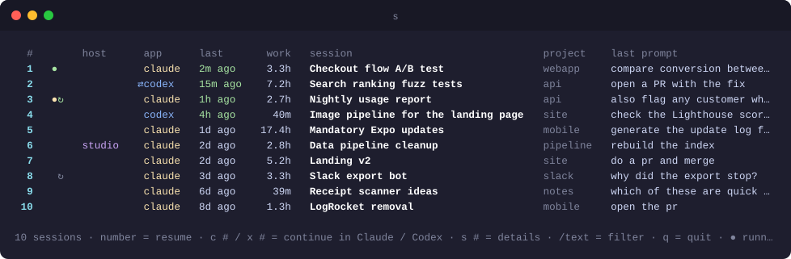
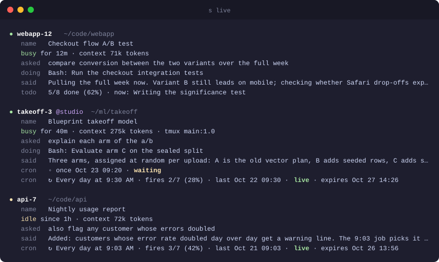
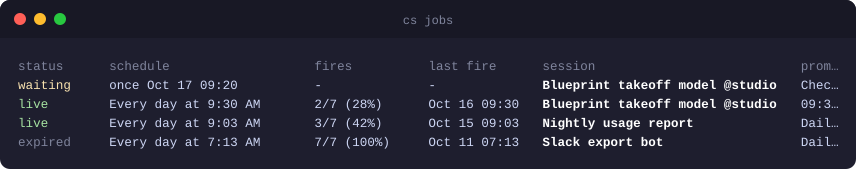
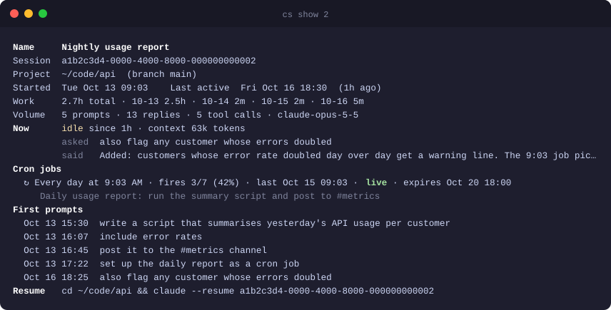
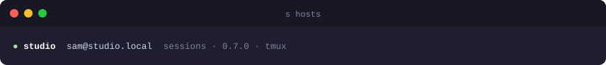
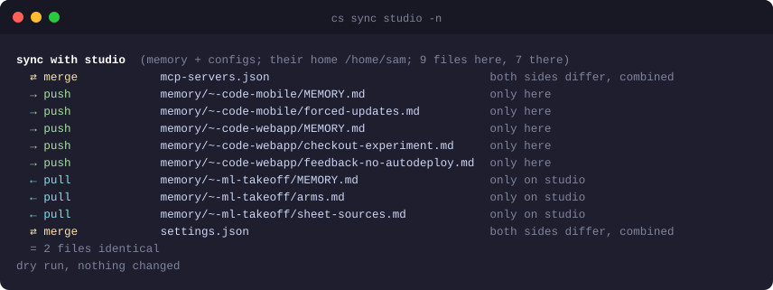

<h1 align="center">cs</h1>

<p align="center">
  Find, watch and resume every <a href="https://claude.com/claude-code">Claude Code</a> and Codex session you have, on every machine you own.
</p>

<p align="center">
  
  
  
  
</p>

<p align="center">
  
</p>

Claude Code keeps each session inside the folder it was started in, so `claude --resume` only
ever shows you one folder's worth. `cs` puts all of them in one list: what each session was
about, how much real work went into it, which ones are running right now, and which ones have
scheduled jobs ticking inside them. Type a number and you are back in that session, even when
it lives on another computer.

## Highlights

- **One list for everything.** Every project, newest first, with the session's name, the hours
  you actually spent in it, and the last thing you asked. Filter by typing.
- **See what is running.** `cs live` shows each open session: busy or idle, what you asked,
  what it is doing this second, the last thing it said, and how far through its checklist it is.
- **Scheduled jobs, tracked.** Sessions that set up cron jobs are marked. You see the schedule,
  how many times it has fired, and whether it is still alive or died with the terminal.
- **Claude Code and Codex in one list.** If you also use the Codex CLI, its sessions show up
  beside your Claude ones, and any session can be continued in the other tool.
- **Your other computers too.** Add a machine once; its sessions join the list. Resuming one
  opens it there over ssh. Sessions running inside tmux are attached, not duplicated.
- **Memories and settings travel with you.** Keep two machines in step with one command,
  in both directions, with a plan shown first and backups kept.
- **Private by design.** One Python file, no dependencies, no accounts, no servers. It reads
  what Claude Code already stores on your disk and talks only to machines you name.

## Install

```sh
curl -fsSL https://raw.githubusercontent.com/mohammadnaraghi/claude-sessions/main/install.sh | sh
```

That is the whole setup. It needs `python3` and Claude Code, puts one file in `~/.local/bin`,
and tells you if that folder is not on your `PATH` yet. Open a new terminal and type `cs`.

- Update any time with `cs update`
- Remove with `rm ~/.local/bin/cs`

If you have [fzf](https://github.com/junegunn/fzf) installed, `cs` uses it automatically for
fuzzy search with a live preview.

## What is running right now

<p align="center">
  
</p>

`cs live` is the view you want when you come back to your desk. For every open session, on
every machine, it tells you what you asked for, which command it is running, what it last
reported, and the checklist progress when the session keeps one. Scheduled jobs that are still
alive are listed underneath.

## Scheduled jobs

<p align="center">
  
</p>

Jobs scheduled inside a Claude Code session only run while that session is open, and they stop
after a week. That is easy to forget. `cs jobs` lists every job you ever set up with its
schedule, how many of its possible runs have happened, and a plain status: live, waiting,
done, expired, cancelled, or dead because the terminal closed.

## Every detail of a session

<p align="center">
  
</p>

`cs show 2` gives you the full picture before you jump in: when it started, how the work was
spread across days, the first and latest prompts, its jobs, and the exact command that resumes
it.

## Your other computers

```sh
cs hosts add studio sam@studio.local   # a name you choose, then the ssh address
cs hosts setup studio                  # copies cs over, done
```

<p align="center">
  
</p>

From then on the other machine's sessions sit in the same list with a host column, and
`cs live` and `cs jobs` cover it as well. Picking one of its sessions starts it there inside
tmux, so closing your laptop only detaches you: the session and its scheduled jobs keep
running, and picking it again drops you back into the same window. A session that is already
running there is attached to, never started twice. Add as many machines as you like, Mac or
Linux, any names you want. It needs ssh with keys, the normal setup between your own machines,
and tmux on the other machine for the keep-running part (`brew install tmux` or
`apt install tmux`; without it `cs` still resumes over plain ssh and says so).

Want the same safety on this machine? `cs --tmux 3` runs a local session inside tmux too.

## Claude Code and Codex

When the [Codex CLI](https://github.com/openai/codex) is installed, its sessions join the list
with an `app` column, read through Codex's own `codex app-server` and cached, so they cost
nothing until Codex has something new. Picking one runs `codex resume` in its folder.

Any session can also be continued in the other tool:

- `cs 3 --codex` (or `x 3` in the picker) imports a Claude conversation into Codex as a new
  thread, with the whole history, using Codex's own importer, and opens it.
- `cs 3 --claude` (or `c 3`) writes the Codex conversation out as a transcript and starts
  Claude Code in the same folder, asking it to read the transcript and say where things stand.

`cs codex` and `cs claude` filter the list by tool. Set `CS_CODEX_ARGS` to pass flags to every
Codex that `cs` starts, for example `export CS_CODEX_ARGS="-p work"` for a profile.

## Keep two machines in sync

<p align="center">
  
</p>

Claude Code learns things about you and your projects as you work, and keeps them on the
machine you were using. `cs sync studio` carries that knowledge, plus your settings, across
both machines in both directions:

- what Claude remembers about each project, and about you
- your settings, instructions, key bindings, custom commands, agents, hooks and skills
- your MCP server list

Nothing changes until you have seen the plan and said yes. Newer copies win, settings and
memory indexes are merged rather than overwritten, something you deleted on one machine is
removed from the other, and everything replaced is kept in a dated backup folder first.
Setting up a brand new machine is `cs migrate to studio`, which copies everything over and
deletes nothing.

## Cheat sheet

| Command | What it does |
|---|---|
| `cs` | the picker: last two weeks, newest first |
| `cs 3` | resume number 3 |
| `cs 3 --codex` · `cs 3 --claude` | continue number 3 in Codex · in Claude Code |
| `cs tiktok` | filter by any word; resumes at once if only one matches |
| `cs running` · `cs cron` · `cs @studio` | only running sessions, only sessions with jobs, only one machine |
| `cs codex` · `cs claude` | only Codex sessions · only Claude Code sessions |
| `cs live` | what every open session is doing |
| `cs jobs` | every scheduled job and its status |
| `cs show 3` | the full story of one session |
| `cs hosts add NAME user@host` | add another machine, then `cs hosts setup NAME` |
| `cs sync NAME` | two-way sync of memories and settings, `-n` for a dry run |
| `cs migrate to NAME` | set up a new machine from this one |
| `cs -d 30` · `cs -a` | look back 30 days · show every session, however short |
| `cs --tmux 3` | run a local session inside tmux so it survives closing the window |
| `cs 3 -- --model opus` | pass extra flags to Claude Code (or Codex) |

Inside the picker: a number resumes, `c 3` and `x 3` continue in Claude Code or Codex, `s 3`
shows details, `/text` filters, `n` and `p` page, `q` quits. With fzf: enter resumes, alt-c and
alt-x continue in Claude Code or Codex.

## Questions

**Does anything leave my machine?** No. There is no account, no server and no telemetry. The
only network traffic is ssh to machines you added yourself, and the update check when you run
`cs update`.

**I use more than one Claude account.** That is fine. Sessions are files on your disk, not
tied to an account, so `cs` sees all of them and resumes any of them.

**Will it slow things down?** The first run reads your history once, a few seconds. After that
it opens instantly. Other machines get about a second to answer; one that is asleep or slow is
shown as of its last answer while a fresh one is fetched in the background, and the ssh
connection is kept open for a few minutes so the next run skips the handshake.

**Can I name my machines whatever I want?** Yes. The name is just a label you type; the ssh
address can be a hostname, an IP, or an alias from your ssh config.

**Does resuming change anything?** No. `cs` runs the same `claude --resume` or
`codex resume` you would type yourself, in the session's own folder. Continuing in the other
tool creates a new session there and leaves the original untouched.

## Requirements

- macOS or Linux
- Python 3.8 or newer, which both already have
- Claude Code, and optionally the Codex CLI

## License

MIT
